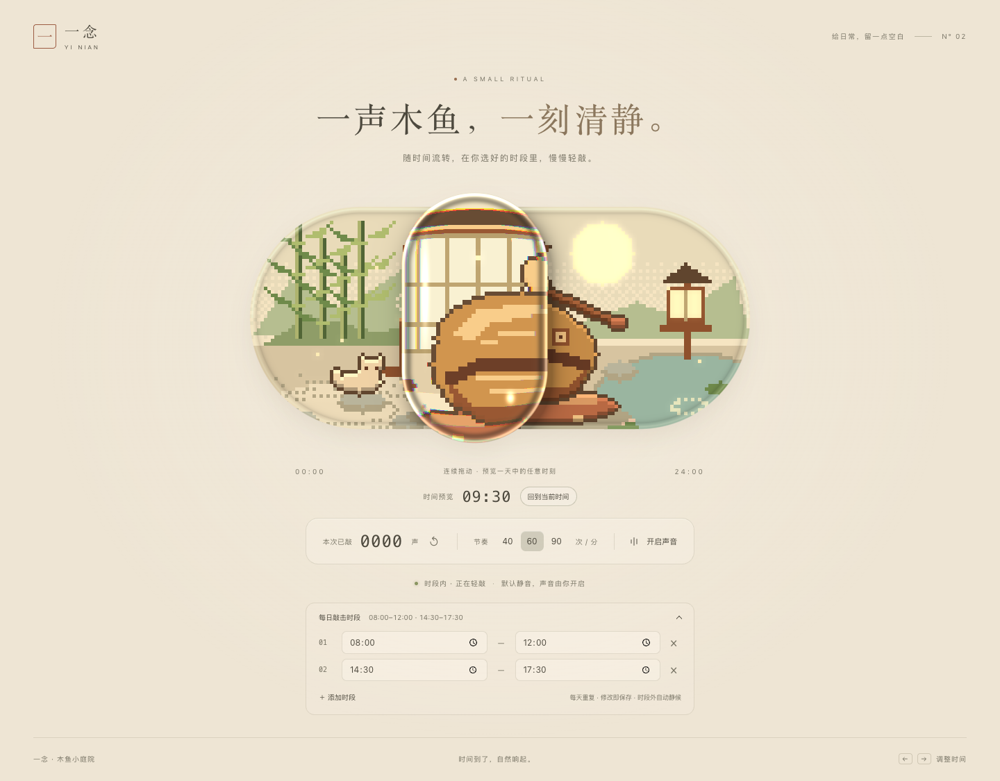
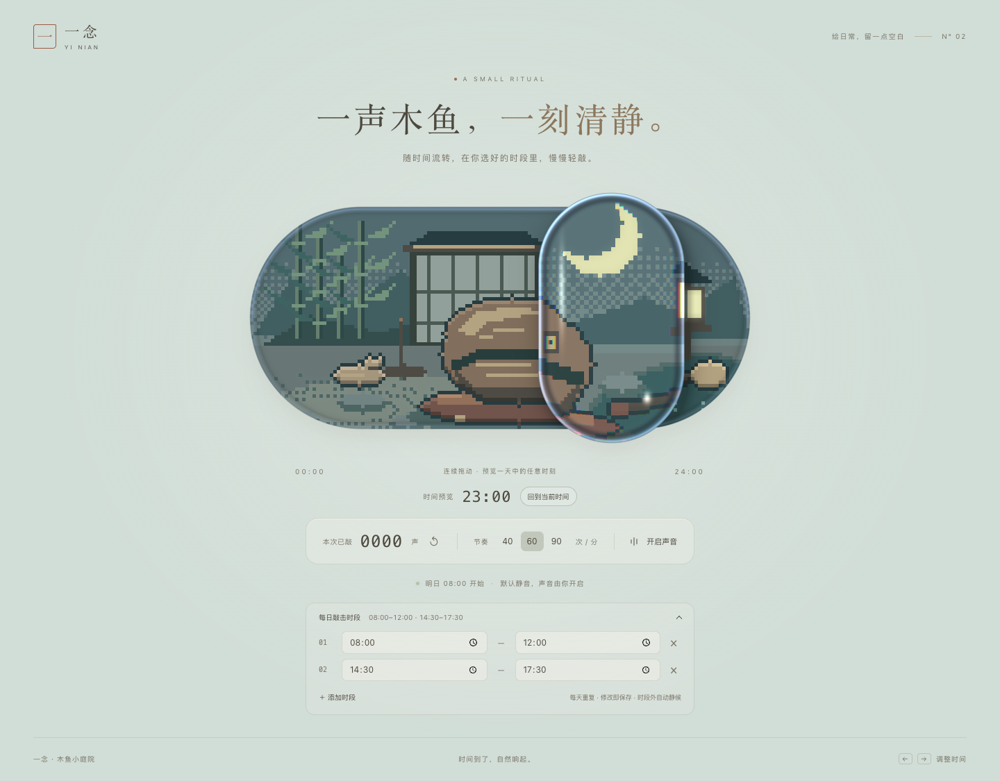

# 一念木鱼 · Yinian Muyu

**一声木鱼，一刻清静。** 玻璃胶囊里的像素庭院，随电脑当地时间流转，在你设定的时段内自动轻敲。



## 下载与打开

前往 **[Releases 下载](https://github.com/heshuhuan6/yinian-muyu/releases/latest)**。普通使用者只需下载成品包，不需要安装 Node.js 或编译源码。

| 版本 | 使用方式 |
| --- | --- |
| macOS 13+ | 下载 Mac ZIP，解压后双击 `一念木鱼.app`；可移入「应用程序」。包含 Apple Silicon 与 Intel。 |
| Windows 10/11 x64 | 下载 Windows ZIP，完整解压后双击其中的 `YinianMuyu.exe`。 |
| 离线网页 | 下载 `一念木鱼.html`，双击用浏览器打开。 |

Mac 版本使用临时签名，尚无 Developer ID 公证。其他电脑首次打开可能需要在「系统设置 → 隐私与安全性」允许打开。Windows 包未进行代码签名，首次运行可能出现 SmartScreen 发布者提示。应用不申请管理员权限，不会安装后台服务。[Apple 的首次打开说明](https://support.apple.com/102445)。

## 让时间自己走

玻璃滑块表示一天中的 **00:00–24:00**，正常运行时跟随本地时钟缓慢移动。默认每天：

| 时段 | 木鱼 |
| --- | --- |
| 08:00–12:00 | 自动敲击 |
| 14:30–17:30 | 自动敲击 |
| 其他时间 | 静候 |

点击「每日敲击时段」修改，设置即时保存在本机。支持最多六段、跨午夜与重叠时段；结束时刻起停止，重叠不会双倍敲击。声音默认关闭，可手动开启；节奏可选每分钟 40、60、90 次。

拖动可无级预览任何时刻，松手保留预览位置。点击「回到当前时间」恢复自动运行。键盘方向键调整 15 分钟，Shift + 方向键调整 60 分钟；Home / End 到两端，Enter / Space 恢复当前时间。

桌面版可固定在左上角或右上角。右键控件或托盘/状态栏图标打开设置。电脑需保持唤醒、应用需保持打开；隐藏/休眠时暂停，恢复后重新校准当前时段，不补敲错过的次数。

## 一座活的小庭院

144×76 CPU 像素缓冲，最近邻显示；固定种子随机数保证布局一致。四套材质光色通过 4×4 Bayer 抖动切换；木槌敲下、池水泛起涟漪，小猫在静候时蜷起休息。玻璃镜头有放大、折射、色散、边缘高光和柔和发光。



运行时离线：无账号、无广告、无遥测、无网络素材。木鱼声在本机合成。支持键盘、无障碍状态、减少动态效果与 WebGL2 不可用时的 2D 回退。

## 本地开发

已在 Node.js 24 下构建。

```sh
npm ci
npm run dev
npm run build
npm run lint
npm run standalone
```

`npm run standalone` 生成 `out/一念木鱼.html`。Mac 需安装 Xcode Command Line Tools，再运行 `npm run mac`，得到 `out/Muyu.app`。Windows 构建机另运行 `npm --prefix windows ci`、`npm run windows`；详见 [Windows 构建与验收](windows/README.md)。

| 路径 | 内容 |
| --- | --- |
| `src/schedule.ts` | 时段、跨午夜、真实时钟与光照 |
| `src/engine.ts` | DOM、输入、持久化、原生桥接与生命周期 |
| `src/motion.ts` | 连续滑块弹簧、敲击节奏、演示与固定步进 |
| `src/world.ts` | CPU 像素庭院、精灵与调色板 |
| `src/renderer.ts` / `src/shaders.ts` | WebGL2 玻璃与 2D 回退 |
| `src/sound.ts` | 本地合成木鱼声 |
| `native/` | macOS AppKit + WKWebView 宿主 |
| `windows/` | Windows 桌面宿主 |
| `out/说明.md` | 中文概念、图层、验收与运行条件 |

网址加 `?demo=1` 可播放拖动演示；真实输入会接管。`window.__render(t)` 从新引擎按固定 60 fps 推进，用于在同一视口复现同一画面。`?renderer=2d` 可检查回退效果。

## 验收

构建与 ESLint 通过。浏览器检查覆盖四个启停边界、跨午夜、三档节奏、连续拖动、键盘、声音、持久化、减少动态效果、资源释放和断网运行。Mac 原生检查覆盖透明窗口、角落定位、置顶、休眠/隐藏恢复和设置展开。Windows 11 实机通过 17 项功能验收、5 项最终 EXE 检查及原生拖动/菜单操作；运行进程网络审计为零 TCP、零 UDP、零外部 URL。

详细测试与平台状态见 [中文说明](out/说明.md) 及每个 Release。Mac 实机验收使用 Apple Silicon。

## 产品演示

[观看 / 下载 30 秒宣传片](https://github.com/heshuhuan6/yinian-muyu/releases/download/v1.0.0/Yinian-Muyu-30s-Promo.mp4)。实际应用画面搭配玻璃特写、时段演示、昼夜滑动与木鱼原声。

## License

[MIT](LICENSE)。React / React DOM / Scheduler / Vite 的许可见 [THIRD_PARTY_NOTICES.md](THIRD_PARTY_NOTICES.md)。

---

**Yinian Muyu** is an offline pixel-art wooden-fish companion for your desktop. Its glass time slider follows your local clock, with configurable daily playing periods and continuous manual preview. Built with React, strict TypeScript, CPU pixel art and a WebGL2 glass lens. Download ready-to-run packages from Releases.
